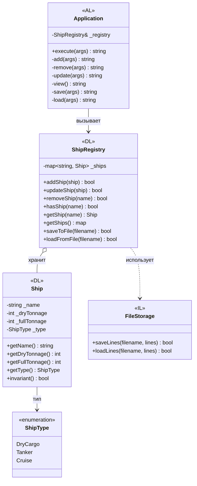
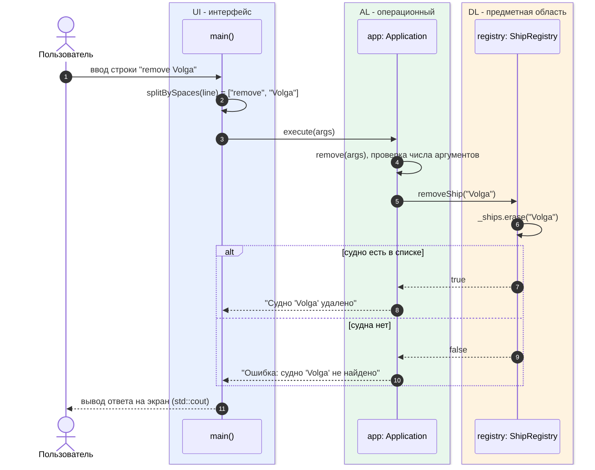

<div align="center">
Министерство науки и высшего образования Российской Федерации <br />
Федеральное государственное бюджетное образовательное учреждение <br />
высшего образования <br />
«Московский государственный технический университет имени Н.Э. Баумана <br />
(национальный исследовательский университет)» <br />
(МГТУ им. Н.Э. Баумана)
</div>
<hr />
<div align="center">
ФАКУЛЬТЕТ «ИНФОРМАТИКА И СИСТЕМЫ УПРАВЛЕНИЯ» <br />
КАФЕДРА «КОМПЬЮТЕРНЫЕ СИСТЕМЫ И СЕТИ» (ИУ6)
</div>
<br />
<div align="center">
ОТЧЁТ <br />
к лабораторной работе №1 <br />
по дисциплине «Современные средства разработки программного обеспечения» <br />
<b>«Изоляция предметной области»</b>
</div>
<br />

Преподаватель: Фетисов М.В.


Студент группы ИУ6-73Б: Архипов А.В.

## Задание

Вариант <N>. Задача «Наблюдаемые суда».

Карточка «судно» должна содержать следующие данные:
- наименование судна;
- сухой тоннаж;
- полный тоннаж;
- тип (сухогруз, танкер, круизный лайнер).

Диаграмма (таблица 3, №<N>): построить диаграмму последовательности выполнения команды remove.

## Словарь предметной области

| Термин | Описание | В программе |
|---|---|---|
| Судно | карточка наблюдаемого судна | Ship |
| Наименование | название судна, одним словом | _name |
| Сухой тоннаж | масса судна без груза и запасов, в тоннах | _dryTonnage |
| Полный тоннаж | масса судна с грузом и запасами, в тоннах (не меньше сухого) | _fullTonnage |
| Тип судна | сухогруз, танкер или круизный лайнер | ShipType, _type |
| Сухогруз | судно для перевозки сухих грузов, в командах `cargo` | ShipType::DryCargo |
| Танкер | судно для перевозки жидких грузов, в командах `tanker` | ShipType::Tanker |
| Круизный лайнер | пассажирское судно, в командах `cruise` | ShipType::Cruise |
| Список наблюдаемых судов | все суда, за которыми ведётся наблюдение | ShipRegistry |
| Файл списка | файл куда сохраняется список судов | FileStorage |

## Архитектура

Программа разбита на 4 уровня:

- UI (l1_UserInterface.cpp) - функция main, читает команды и выводит ответ
- AL (l2_ApplicationLayer) - класс Application, проверяет аргументы команд и вызывает методы списка судов
- DL (l3_DomainLayer) - классы Ship, ShipRegistry и перечисление ShipType
- IL (l4_InfrastructureLayer) - класс FileStorage, пишет и читает строки из файла

Каждый уровень обращается только к уровню ниже. Application сам ничего не выводит, а возвращает строку с ответом в main.
FileStorage про суда ничего не знает, суда в строки переводит ShipRegistry.

Диаграмма классов:



Диаграмма последовательности для команды remove:



Как выполняется `remove Volga`: main разбивает строку на слова и вызывает `app.execute(args)`.
Application проверяет количество аргументов и вызывает `registry.removeShip("Volga")`.
ShipRegistry удаляет судно из map и возвращает true, или false если такого судна нет.
По этому значению Application формирует ответ, а main выводит его на экран.
IL в этой команде не участвует, к файлу программа обращается только при save и load.

## Команды

```
add <наименование> <сухой тоннаж> <полный тоннаж> <тип: cargo | tanker | cruise>
remove <наименование>
update <наименование> <сухой тоннаж> <полный тоннаж>
view
save <файл>
load <файл>
exit
```

Тип судна при `update` не меняется.

Пример:

```
add Volga 12000 15000 cargo
Судно 'Volga' добавлено
add Neva 3000 4500 cruise
Судно 'Neva' добавлено
remove Neva
Судно 'Neva' удалено
remove Neva
Ошибка: судно 'Neva' не найдено
view
Наблюдаемых судов: 1
Volga | тип: сухогруз | сухой тоннаж: 12000 т | полный тоннаж: 15000 т
```

Инвариант класса Ship:

```cpp
bool Ship::invariant() const
{
    return !_name.empty() && isShipDataCorrect(_dryTonnage, _fullTonnage);
}
```

где `isShipDataCorrect` проверяет что сухой тоннаж больше 0, а полный тоннаж не меньше сухого.
Тип судна задаётся перечислением ShipType, поэтому неправильного типа у объекта быть не может.

## Сборка и тесты

```
./configure
make
test/run-tests
```

Тесты лежат в папке test: в файлах .test команды, в .expected правильный вывод.

- 01_add_view - добавление и вывод
- 02_remove - удаление (команда из варианта)
- 03_update - изменение судна
- 04_errors - неправильные команды и данные
- 05_save_load - сохранение и загрузка из файла (в т.ч. файлы с ошибками broken.data и broken_type.data)
- 06_no_exit - пустые строки и конец ввода без exit

Репозиторий: https://github.com/Artemiy25/l1

Тесты: https://github.com/Artemiy25/l1/tree/main/test

## Выводы

В ходе работы были получены навыки составления словаря предметной области и диаграмм классов. Программа разделена на уровни UI, AL, DL и IL,
каждый уровень использует только нижний. Построена диаграмма последовательности для команды remove. Написаны автотесты, настроен CI в GitLab.
